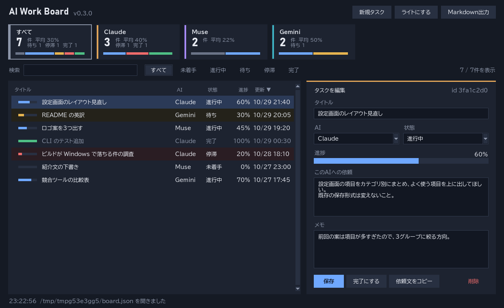
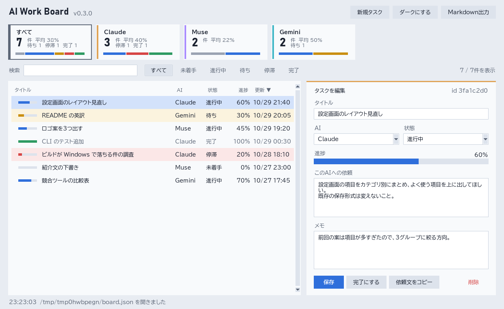

# AI Work Board（AI作業進捗ボード）

各AI（Claude / Muse / Gemini）との作業がどのくらい進んでいるか、
このAIにはこんな作業をお願いしたいかを、1枚の画面で見て・書けるツールです。
データはすべて手元のPCに保存します。アカウント登録なし・同期なしです。

## 画面



上にAIごとのレーン、左に一覧、右に選んだタスクの編集欄が並びます。
ダークとライトは右上のボタンで切り替えられ、選んだ方を次回も使います。



## ダウンロード

- Windows: [Releases](../../releases) の `AIWorkBoard.exe` を置いた場所から起動するだけです。
  - コード署名はしていないので、初回は SmartScreen の「詳細情報」→「実行」になる場合があります。
  - exe と同じフォルダに `board.json` と `BOARD.md` が作られます。

## 使い方

1. **見る** — 上のレーンで、AIごとの件数・平均進捗（未完了の分）と、状態の内訳（未着手・進行中・待ち・停滞・完了の色の帯）が分かります。レーンを押すとそのAIだけに絞り込み、もう一度押すと戻ります。一覧の進捗は状態の色のバーで出ます。
2. **探す** — 検索欄でタイトル・依頼・メモ・idを探せます。状態のボタンでも絞り込めます。列の見出しを押すと並べ替えます（もう一度押すと逆順）。
3. **書く** — 右の欄にタイトル・AI・状態・進捗・「このAIへの依頼」・メモを入力して「保存」します。
4. **頼む** — 「依頼文をコピー」で、そのAIに貼り付ける文章（依頼・メモ・board.json の更新のしかた付き）をクリップボードに入れます。
5. **進める** — 進捗のバーを押すかドラッグ（選んで左右キーなら5%ずつ）、状態を変える、「完了にする」で100%にします。
6. **片づける** — 不要なタスクは「削除」します。

AIやCLIが `board.json` を書き換えると、開いている画面に2秒ほどで反映されます。
編集中のタスクが外で書き換えられていたら、保存するときに上書きしてよいか確認します。

キー操作: `Ctrl+S` 保存 / `Ctrl+N` 新規 / `Ctrl+F` 検索 / 一覧で `Delete` 削除

画面の設定（ダーク/ライト）は `board.json` と同じフォルダの `ai_work_board_ui.json` に入ります。AIが読む必要はありません。

## データの形（人間にもAIにも読める）

`board.json` と `BOARD.md` は1組です。保存するたびに両方が更新されます。

- `board.json`: 機械が読むデータ。タスク1件は次の形です。

```json
{
  "id": "abc12345",
  "title": "タイトル",
  "ai": "Muse",
  "status": "in_progress",
  "progress": 40,
  "request": "このAIへの依頼",
  "notes": "メモ",
  "created": "2026-10-29T00:00:00Z",
  "updated": "2026-10-29T00:00:00Z"
}
```

- `status` は `todo`（未着手） / `in_progress`（進行中） / `waiting`（待ち） / `blocked`（停滞） / `done`（完了）です。
- `BOARD.md`: 人が読む一覧。AIごとにタスクと依頼をまとめます。

## AIとの提携のしかた（AIへのお願い）

このツールのデータを扱うAIは、次のルールで読む・書いてください。

1. まず `board.json` を読んで、既存のタスクと進捗を確認してください。
2. 新しい依頼は追加し、既存のタスクは上書きで消さないでください。
3. 作業が進んだら `status` と `progress` と `updated` を更新してください。完了したら `status: done` / `progress: 100` にしてください。
4. 依頼の内容は `request` に、経緯や注意点は `notes` に書いてください。
5. 人の名前やメールアドレスをタスクに入れないでください。連絡はこのボードと GitHub Issues のみで行います。

GUIを使わずに同じ操作をする場合は、CLIが使えます。

```text
python ai_work_board.py --list
python ai_work_board.py --add "タイトル" --ai Muse --status in_progress
python ai_work_board.py --update <id> --progress 60 --status in_progress
python ai_work_board.py --done <id>
python ai_work_board.py --export
```

`--data` で `board.json` の場所を変えることもできます。
環境変数 `AI_WORK_BOARD_DATA` でも指定できます。

## 開発

Python 3.11以上、標準ライブラリのみです。外部パッケージは要りません。

```text
python ai_work_board.py
python test_ai_work_board.py   # データとCLIの確認（窓は出ません）
```

exe を作る場合（Windows）:

```text
pip install pyinstaller
pyinstaller --onefile --windowed --name AIWorkBoard ai_work_board.py
```

参考にした既存の作り: 1枚の画面でCLIと同じ操作ができる形、
結果を JSON と Markdown の1組で残す形、exe 1本で置いた場所から起動する形です。

## 連絡

- 不具合や要望は GitHub Issues までお願いします。
- メールでの連絡先は設けていません（noreply）。
